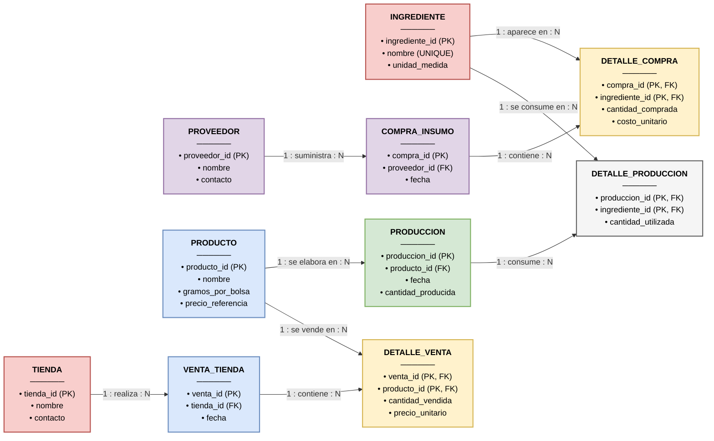

# Información de la entrevista – Negocio de Karinto

### 1. ¿Cómo fue que se animó a armar este negocio?

Por necesidad, quería tener un ingreso propio para cubrir sus gastos.

### 2. ¿Qué producto venden en este negocio?

Venden Karinto. El precio es de aproximadamente 0,50 Bs por gramo y cada bolsita cuesta aproximadamente 2 Bs.

### 3. ¿Qué es lo que más les dificulta en el día a día?

Algunos productos e ingredientes resultan cada vez más caros y además existe dificultad para llevar correctamente el conteo de los productos y las ganancias.

### 4. Cuando el cliente paga, ¿ustedes le dan algún tipo de recibo o comprobante?

No utilizan recibos. Según la información proporcionada, si el negocio no supera una ganancia de 1.500 Bs, no necesita presentar recibo.

### Narrativa del Negocio
El negocio se dedica a la elaboración y comercialización artesanal de Karinto, un producto que se empaqueta en bolsitas con un costo aproximado de 2 Bs (calculado a un precio base de 0,50 Bs por gramo). El flujo de comercialización opera en una cadena de distribución directa e indirecta: la Dueña produce y vende el producto a distintos Vendedores (o distribuidores), quienes a su vez revenden el Producto a los Clientes finales.

Actualmente, el negocio enfrenta dos problemas principales en su operación diaria:

Falta de control financiero e inventario: No existe un registro estructurado para llevar el conteo exacto de la producción, el stock disponible y el cálculo real de ganancias frente al costo variable de los ingredientes.

Ausencia de comprobantes: Las ventas no emiten recibos debido a que el margen operativo se mantiene por debajo del umbral tributario obligatorio (1.500 Bs de ganancia); sin embargo, esto genera vacíos de información sobre qué productos se vendieron, a quién y mediante qué transacción.

### Base de datos conceptual

El modelo registra el recorrido **compra de insumos → producción de productos → venta a tiendas**. Para evitar mezclar datos, los ingredientes y productos tienen catálogos propios; las compras, los lotes de producción y las ventas se registran en sus tablas principales, y sus artículos se detallan en tablas separadas.

La cantidad de cada ingrediente utilizado se registra en `DETALLE_PRODUCCION`. La cantidad de cada producto vendido, junto con su precio de venta, se registra en `DETALLE_VENTA`. El esquema relacional ampliado y su normalización se describen más abajo.

# 📊 Sistema de Control de Rentabilidad y Producción - Karinto

Este repositorio contiene el diseño e implementación de una base de datos relacional orientada a la evaluación financiera y control operativo para un microemprendimiento artesanal de elaboración de **Karinto** (producto comercializado a Bs 2.00 / unidad en canales B2B locales).

---

## 📌 Contexto del Negocio y Problemática

En un entorno con inflación en los insumos (harina, azúcar, aceite y empaques), mantener precios fijos de venta ($0.50 \text{ Bs/gramo}$ o $2.00 \text{ Bs}$ por bolsita) puede derivar en **márgenes negativos o pérdida operativa**.

El objetivo central de este sistema es **cruzar el costo real de materias primas con el volumen de producción** para determinar si el margen bruto cubre la fabricación antes de la distribución a tiendas clientes.

---

## 📐 Modelo Conceptual y Diagrama de Entidades

El flujo del modelo conecta las salidas financieras desglosadas (catalogo e ingredientes) con la fabricación y las entregas detalladas a la tienda cliente:

$$\text{Ganancia Neta} = \text{Ingresos por Ventas} - \text{Costo Total de Insumos}$$

---

### 📋 Restricciones e Integridad del Modelo

* **Catálogos `INGREDIENTE`, `PRODUCTO`, `PROVEEDOR` y `TIENDA`**: Cada catálogo identifica sus elementos con una clave primaria; los nombres deben ser únicos y las unidades deben registrarse de forma consistente.
* **Tablas de detalle**: Cada fila debe referirse a una compra, producción o venta existente. Las claves compuestas evitan repetir el mismo ingrediente o producto dentro de una misma transacción.
* **Cantidades y precios**: Las cantidades deben ser positivas. `DETALLE_COMPRA` conserva el costo unitario pagado y `DETALLE_VENTA` conserva el precio unitario aplicado en cada venta.
* **`DETALLE_PRODUCCION`**: Registra cuánto se utilizó de cada ingrediente en cada lote; no representa productos vendidos.
* **`DETALLE_VENTA`**: Registra qué producto se vendió, en qué cantidad y a qué precio. Los subtotales y el total de la venta se calculan a partir de sus líneas.

---

## 📐 Modelo Relacional Normalizado

El diseño separa los encabezados de sus líneas de detalle. Las claves primarias (PK) identifican cada registro y las claves foráneas (FK) conectan las tablas.

| Tabla | Clave y atributos | Relación / finalidad |
|---|---|---|
| **INGREDIENTE** | PK `ingrediente_id`; nombre único; unidad_medida | Catálogo de materias primas e insumos. |
| **PROVEEDOR** | PK `proveedor_id`; nombre; contacto | Catálogo de vendedores de insumos. |
| **COMPRA_INSUMO** | PK `compra_id`; FK `proveedor_id`; fecha | Encabezado de una compra. |
| **DETALLE_COMPRA** | PK compuesta (`compra_id`, `ingrediente_id`); ambas FK; cantidad_comprada; costo_unitario | Una fila por ingrediente comprado; permite varios ingredientes por compra. |
| **PRODUCTO** | PK `producto_id`; nombre; gramos_por_bolsa; precio_referencia | Catálogo de productos elaborados. |
| **PRODUCCION** | PK `produccion_id`; FK `producto_id`; fecha; cantidad_producida | Lote de producto elaborado. |
| **DETALLE_PRODUCCION** | PK compuesta (`produccion_id`, `ingrediente_id`); ambas FK; cantidad_utilizada | Cantidad de cada ingrediente consumida por lote. |
| **TIENDA** | PK `tienda_id`; nombre; contacto | Catálogo de tiendas o distribuidores clientes. |
| **VENTA_TIENDA** | PK `venta_id`; FK `tienda_id`; fecha | Encabezado de una venta o entrega. |
| **DETALLE_VENTA** | PK compuesta (`venta_id`, `producto_id`); ambas FK; cantidad_vendida; precio_unitario | Una fila por producto vendido, con la cantidad y el precio de esa venta. |

### Formas normales

* **Primera forma normal (1FN):** los campos guardan valores atómicos; no se almacenan listas de ingredientes o productos en una sola celda. Cada línea de compra, producción o venta ocupa su propia fila.
* **Segunda forma normal (2FN):** en las tablas de detalle, los atributos dependen de la clave compuesta completa (la transacción y el ingrediente o producto asociado).
* **Tercera forma normal (3FN):** los datos descriptivos se mantienen en los catálogos `INGREDIENTE`, `PRODUCTO`, `PROVEEDOR` y `TIENDA`. Compras, ventas y detalles usan claves foráneas en vez de repetir nombres o contactos, y no almacenan subtotales o totales que puedan calcularse a partir de cantidad y precio.

Por tanto, el modelo propuesto está en 1FN, 2FN y 3FN si se aplican estas claves y se mantiene un único renglón por ingrediente o producto en cada transacción. `DETALLE_VENTA` registra la cantidad de producto vendido; `DETALLE_PRODUCCION` registra la cantidad de ingrediente utilizada. Son cantidades distintas y se relacionan mediante la producción, no se mezclan en una misma tabla.

El importe de cada línea de venta se calcula como `cantidad_vendida × precio_unitario`; el total se obtiene sumando las líneas de `DETALLE_VENTA`. Se conserva el precio aplicado históricamente, aunque el precio de referencia del producto cambie.

---

## 📁 Estructura del Repositorio

* `README.md` — Contexto del proyecto, diagrama y modelo relacional normalizado.
* `README1.md` — Información de la entrevista y explicación del modelo propuesto.